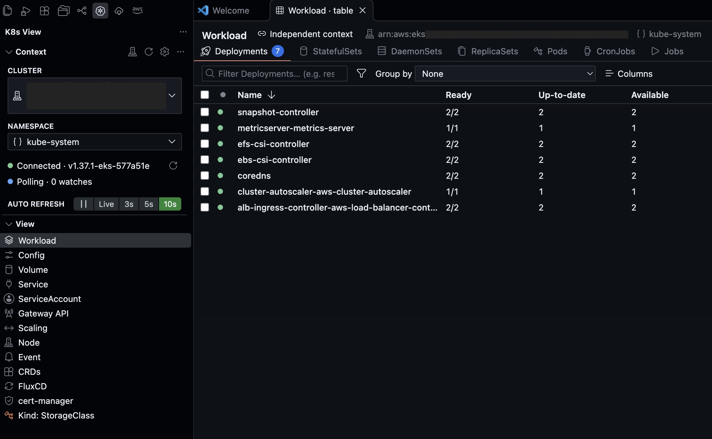
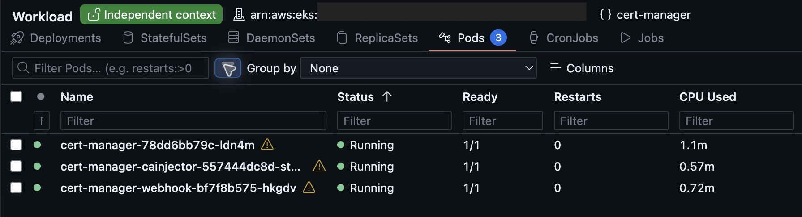
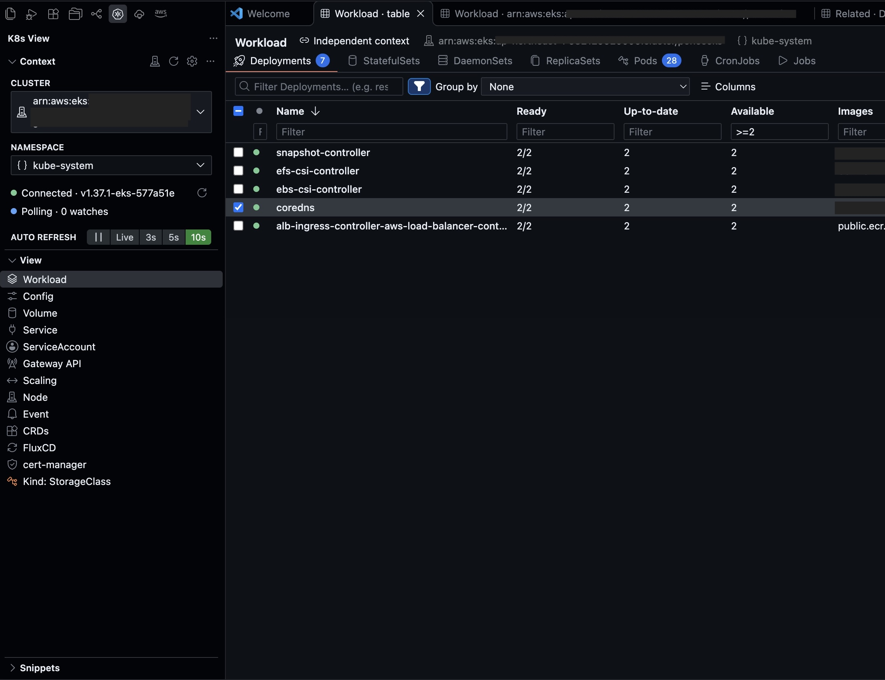
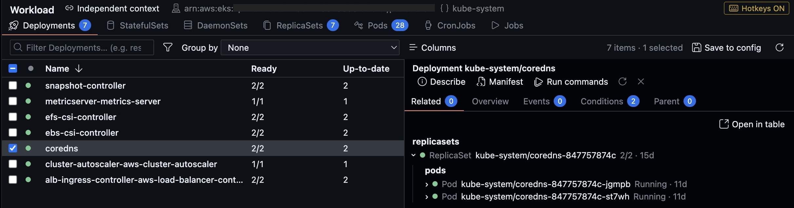
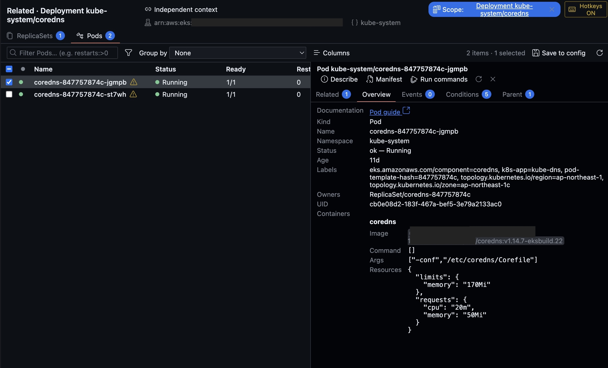
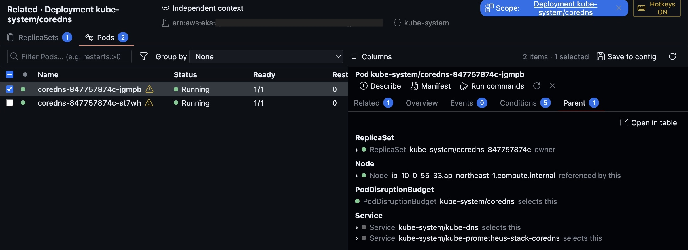
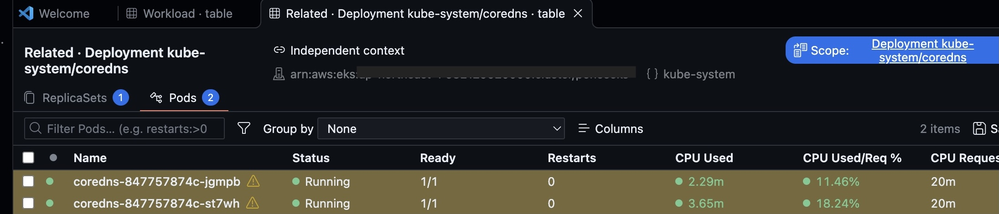
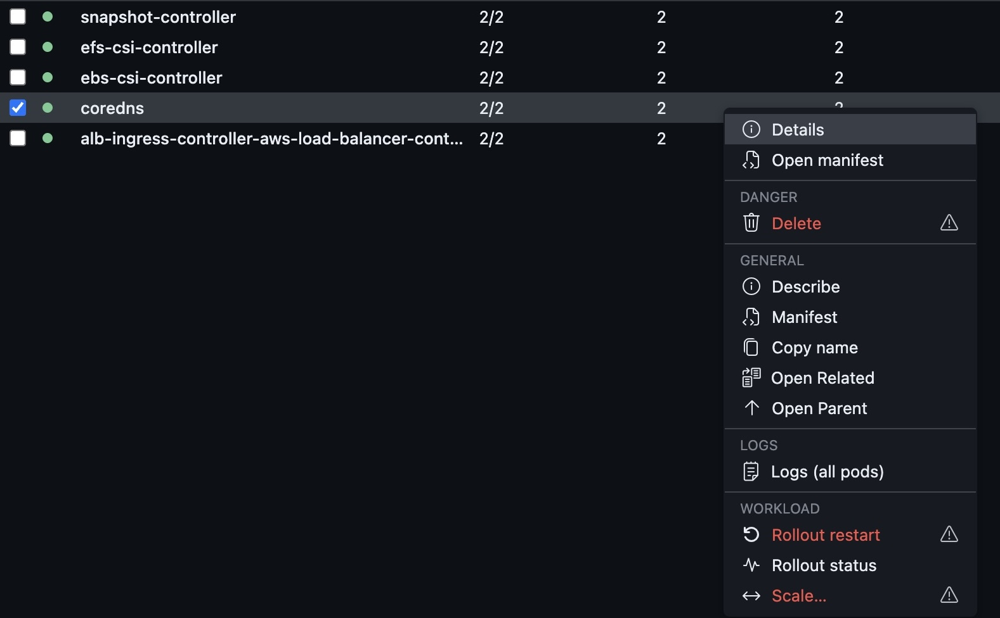
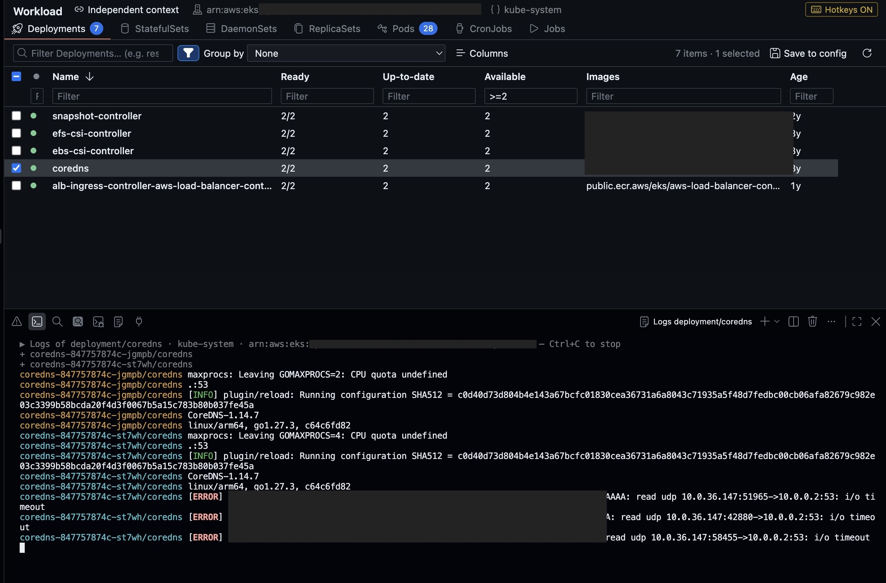

# K8s View 0.0.6 — giao diện và tính năng

K8s View hiển thị tài nguyên Kubernetes bằng bảng trong editor của VS Code. Sidebar chứa **Context**, **View** và **Snippets**. Bạn có thể mở nhiều bảng, chọn cluster/namespace riêng cho từng tab và lần theo quan hệ giữa tài nguyên mà vẫn giữ bảng đang điều tra.

Ảnh trong hướng dẫn được chụp từ bản Debug 0.0.6 trên cluster thật. Các thông tin nhạy cảm đã được làm mờ.

## 1. Sidebar chọn view, editor hiển thị tài nguyên

Trong **Context**, bấm nút cluster hoặc namespace để mở Quick Pick của VS Code. Tên context dài được xuống dòng trong sidebar. Namespace có thể là một tên cụ thể hoặc **All namespaces**; nếu không có quyền liệt kê namespace, bạn có thể nhập tên trực tiếp.

Trong **View**, bấm **Workload**, **Service**, **Config**, **Node** hoặc view khác để mở bảng tương ứng trong editor. Danh sách view thay thế cây tài nguyên ở sidebar. Dùng **Switch view…** để chọn view, **Show/hide views…** để điều chỉnh danh sách.

Ví dụ, mở **Workload → Deployments** để xem readiness, số replica cập nhật/sẵn sàng, image và tuổi tài nguyên. Nhấp đôi một dòng để mở drawer chi tiết; nhấp phải để xem hành động phù hợp với loại tài nguyên đó.



## 2. Mở nhiều tab cùng một view

Bạn có thể giữ hai bảng Workload mở cùng lúc:

1. Nhấp phải **Workload** trong sidebar → **Open in New Tab**, hoặc bấm nút cùng tên trên thanh tiêu đề editor của bảng hiện tại.
2. Tab mới tự bật **Independent context**. Nếu mở từ một bảng cùng view, tab mới lấy cluster và namespace của bảng đó làm điểm bắt đầu; trường hợp khác dùng context chung.
3. Chọn cluster và namespace trong header của tab mới.
4. Kéo tab sang editor group khác nếu cần so sánh song song.

Command Palette cũng có **K8s View: Open in New Tab**. Mỗi bảng có session tài nguyên riêng, nên bạn có thể giữ các section đang xem khác nhau.

## 3. Context độc lập cho từng tab

Khi **Independent context** tắt, bảng theo cluster và namespace trong **Context** của sidebar. Hai nút cluster/namespace trong header hiển thị lựa chọn hiện tại nhưng không cho đổi trực tiếp.

Bật **Independent context** để tách bảng khỏi context chung. Khi đó, hai nút trong header được bật:

- Nút cluster mở danh sách context từ kubeconfig cho riêng tab.
- Nút namespace cho chọn namespace, **All namespaces** hoặc **Enter namespace…**.
- Thay đổi context trong sidebar không đổi lựa chọn của tab độc lập.
- Tắt **Independent context** để theo lại context chung hiện tại.
- Đóng tab sẽ bỏ lựa chọn riêng, không thay đổi context chung. Lựa chọn riêng cũng không được khôi phục sau khi reload cửa sổ.

Ví dụ trong ảnh: sidebar vẫn là `kube-system`, nhưng tab Workload thứ hai dùng `cert-manager`. Cách này phù hợp khi so sánh hai namespace hoặc hai cluster.



Việc chọn context của K8s View không thay đổi `current-context` trong kubeconfig. Hành động trên tài nguyên dùng context của bảng đang thao tác.

## 4. Lọc bằng biểu thức, sắp xếp và nhóm dữ liệu

Ô tìm kiếm hỗ trợ văn bản thường và điều kiện theo cột. Ví dụ trong bảng Pods:

```text
restarts:>0 age:<1h
```

Biểu thức trên tìm Pod có số lần restart lớn hơn 0 **và** tuổi dưới một giờ. Qualifier dùng ID cột hoặc tên cột chuyển thành slug; ví dụ `CPU Used` tương ứng `cpu-used`.

Bấm biểu tượng phễu để hiện hàng lọc dưới tiêu đề. Bộ lọc được nhớ riêng theo section.

| Biểu thức | Cách dùng |
| --- | --- |
| `>0`, `>=2`, `<=5` | So sánh số, ví dụ Restarts hoặc Available |
| `<1h`, `>=2d` | Lọc tuổi tài nguyên; hỗ trợ `s`, `m`, `h`, `d`, `w` |
| `>500m` | Lọc cột CPU theo millicore |
| `>1Gi` | Lọc cột memory theo dung lượng |
| `>100%` | Lọc cột phần trăm |
| `=Running`, `!=Running` | Bằng/khác chính xác, không phân biệt hoa thường |
| `!pending` | Không chứa chuỗi `pending` |
| `Running\|Pending` | Khớp một trong hai nhánh trong cùng cột |

Các cột kết hợp bằng AND, các nhánh `|` trong một biểu thức kết hợp bằng OR. Biểu thức không hợp lệ được đánh dấu kèm lý do và không loại dòng dữ liệu; sửa biểu thức để áp dụng bộ lọc.



**Group by** cho phép nhóm theo namespace, kind, status, label hoặc cột dữ liệu. Ví dụ, trong Pods chọn **Node** để gom các Pod theo Node đang chạy; chọn **None** để trở lại danh sách phẳng.

Bạn cũng có thể ẩn/hiện cột qua **Columns**, kéo đổi thứ tự hoặc điều chỉnh độ rộng. **Save to config** ghi bố cục cột vào định nghĩa view.

## 5. Drawer ưu tiên Related, giữ vị trí điều tra

Nhấp đôi tài nguyên để mở drawer bên phải. Drawer mở đầu ở **Related**; khi bạn chuyển tab chi tiết rồi mở dòng khác, tab đang chọn được giữ lại. Kéo cạnh trái để đổi chiều rộng, bấm refresh để tải lại hoặc `Escape` để đóng.

| Tab | Nội dung |
| --- | --- |
| **Related** | Tài nguyên liên quan; có thể mở rộng nhiều cấp, ví dụ Deployment → ReplicaSet → Pods |
| **Overview** | Kind, tên, namespace, status, age, labels, owners, UID; container của Pod và liên kết tài liệu cho kind được hỗ trợ |
| **Events** | Event gắn với tài nguyên |
| **Conditions** | Type, status, reason, message và thời điểm chuyển trạng thái |
| **Parent** | Tài nguyên chủ sở hữu, tham chiếu hoặc chọn tài nguyên hiện tại |

Các nút **Describe**, **Manifest** và **Run commands** nằm ngay đầu drawer. Lệnh cụ thể tùy loại tài nguyên và policy hiện tại.



## 6. Pod Overview hiển thị cấu hình container

Mở **Workload → Pods**, nhấp đôi một Pod rồi chọn **Overview**. Phần **Containers** hiển thị từng container cùng:

- **Image:** image reference trong Pod spec, gồm registry/repository và tag hoặc digest.
- **Command:** mảng command được khai báo trong Pod spec.
- **Args:** mảng đối số được khai báo trong Pod spec.
- **Resources:** requests và limits đã cấu hình.

`Command: []` hoặc `Args: []` nghĩa là Pod spec không khai báo override tương ứng; đây không phải giá trị entrypoint mặc định được đọc từ image. **Resources** là cấu hình yêu cầu/giới hạn, còn mức CPU/memory đang sử dụng nằm trong bảng khi cluster có metrics API và tài khoản có quyền đọc.

Với các kind Kubernetes chuẩn được hỗ trợ, trường **Documentation** mở hướng dẫn chính thức tương ứng. Extension không tự đoán URL tài liệu cho custom resource.



## 7. Parent và bảng Related/Parent có scope

**Parent** giúp đi ngược từ tài nguyên đang xem. Ví dụ, một Pod có thể hiển thị ReplicaSet sở hữu nó, Node được gán, Service hoặc PodDisruptionBudget chọn Pod đó. Quan hệ khả dụng phụ thuộc cấu hình view và dữ liệu tài nguyên.



Có hai cách đưa quan hệ ra bảng riêng:

- Nhấp phải dòng → **Open Related** hoặc **Open Parent**.
- Trong drawer **Related** hoặc **Parent**, bấm **Open in table**.

Tab kết quả được giới hạn theo tài nguyên nguồn và cập nhật quan hệ khi tài nguyên thay đổi. Ví dụ, bảng Related của Deployment chỉ liệt kê ReplicaSet và các Pod liên quan.

Chip **Scope** ở header cho biết nguồn giới hạn. Bấm tên nguồn để mở manifest. Bấm **×** để xem toàn bộ tài nguyên thuộc các kind của tab trong context/namespace hiện tại; bấm **Restore** để bật lại giới hạn. Bạn tiếp tục dùng section, bộ lọc, sắp xếp và drawer trong bảng này như bảng thông thường.



## 8. Hành động trên tài nguyên và logs nhiều Pod

Menu nhấp phải cung cấp **Describe**, **Manifest**, **Copy name**, **Open Related**, **Open Parent** cùng các hành động riêng của kind.

**Delete** hỗ trợ cả custom resource và tài nguyên cluster-scoped, bao gồm chọn nhiều tài nguyên khác loại. Policy lệnh nguy hiểm vẫn áp dụng: mặc định chặn; đặt `k8sView.commands.dangerous` thành `confirm` để xem xác nhận trước khi chạy các lệnh như delete, scale hoặc rollout restart.



Với Deployment, StatefulSet, DaemonSet, ReplicaSet hoặc Job, chọn **Logs (all pods)** để gom log vào một terminal. Mỗi prefix `pod/container` có màu riêng; log level được tô màu. Pod mới khớp selector được thêm vào stream trong quá trình rollout hoặc scale. Với Pod đơn lẻ, dùng **Logs** hoặc **Logs of container…**. Log được stream qua Kubernetes API, không cần `kubectl`.



## 9. Cập nhật dữ liệu và các view có sẵn

Trong **Context**, chọn **Live** để nhận watch updates, **3s / 5s / 10s** để polling hoặc **Pause** để dừng cập nhật.

Bảng chỉ watch section đang mở. Section chưa tải có thể chưa có số lượng; section không hoạt động có thể giữ dữ liệu đã tải và được cập nhật khi mở lại. Sidebar hiện dùng để chọn view, không duy trì cây tài nguyên và các watch metrics của cây cũ.

Các view tích hợp gồm Workload, Config, Volume, Service, ServiceAccount, Gateway API, Scaling, Node, Event và CRDs. **Browse resource kind…** cho phép mở một kind bất kỳ được cluster phục vụ. Preset **FluxCD** và **cert-manager** xuất hiện khi cluster có các CRD tương ứng; section của kind không tồn tại được ẩn.

**Snippets** vẫn chứa các lệnh tái sử dụng theo context/namespace chung. Dùng **Create snippet…** để tạo lệnh có tham số `${input:name}`. Hotkey bảng mặc định tắt; bật qua status bar **K8s keys**, rồi nhấn `?` để xem danh sách.
