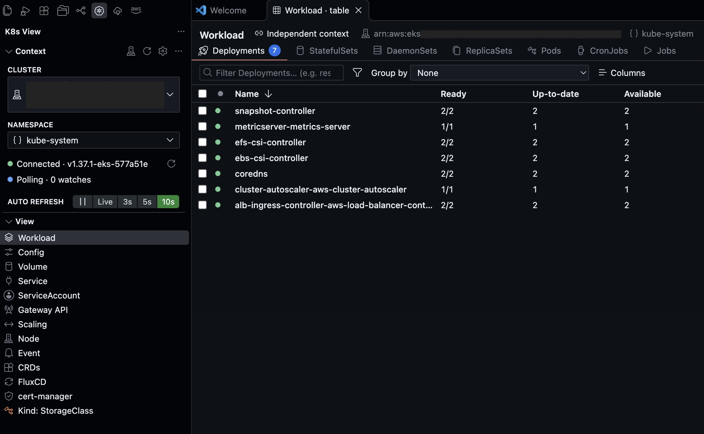
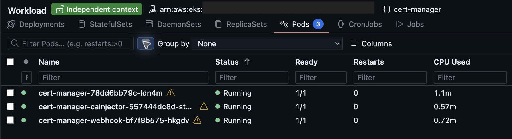
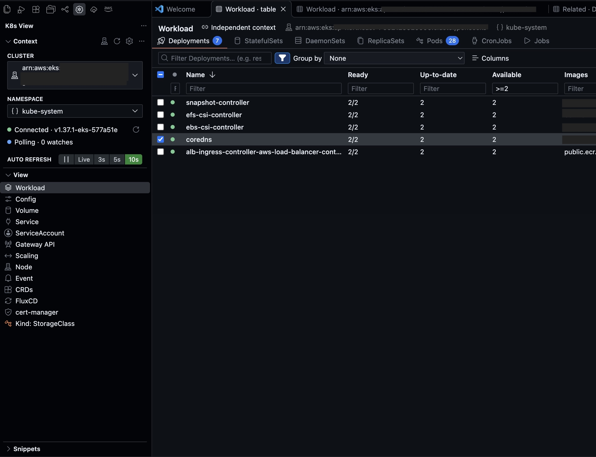
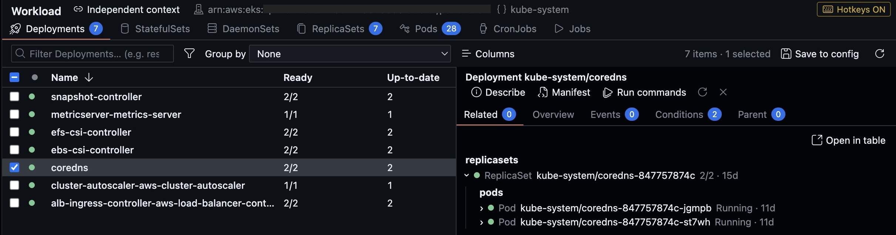
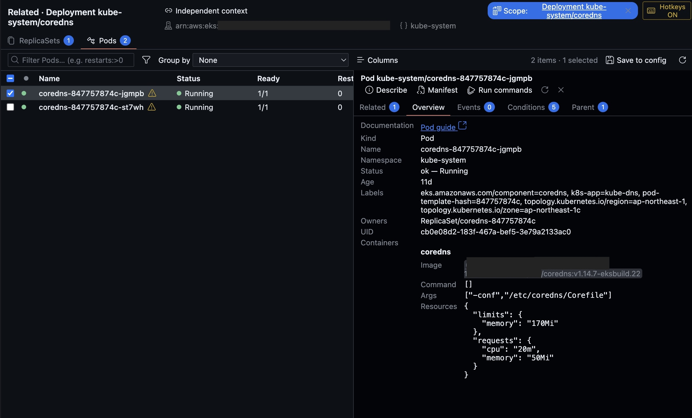
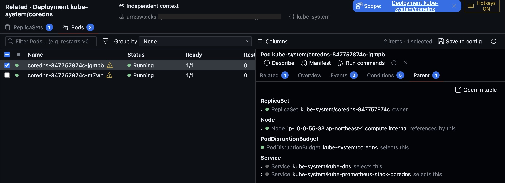
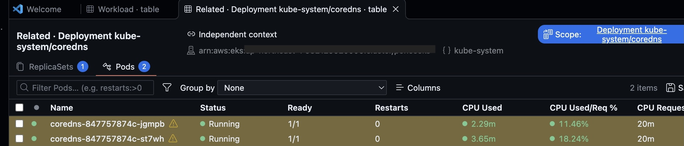
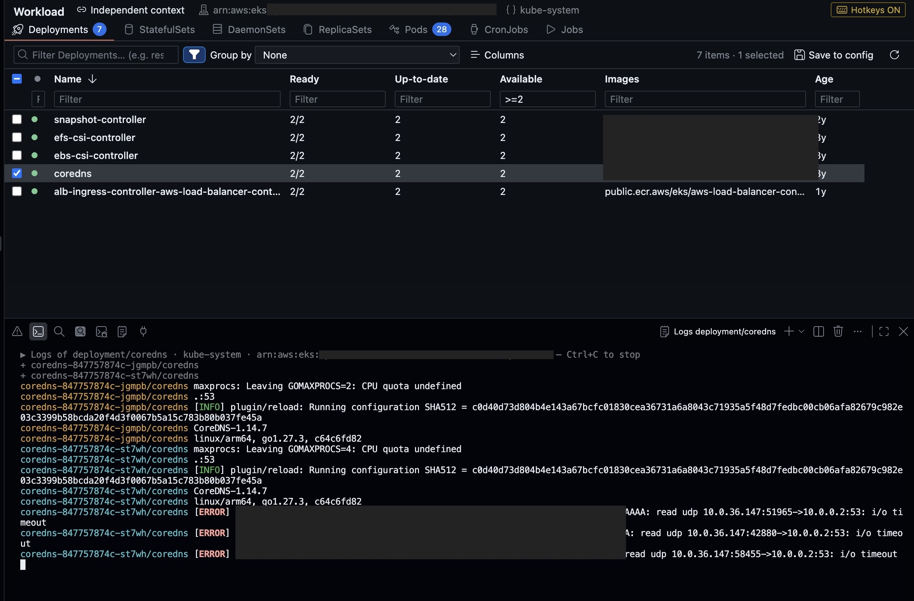
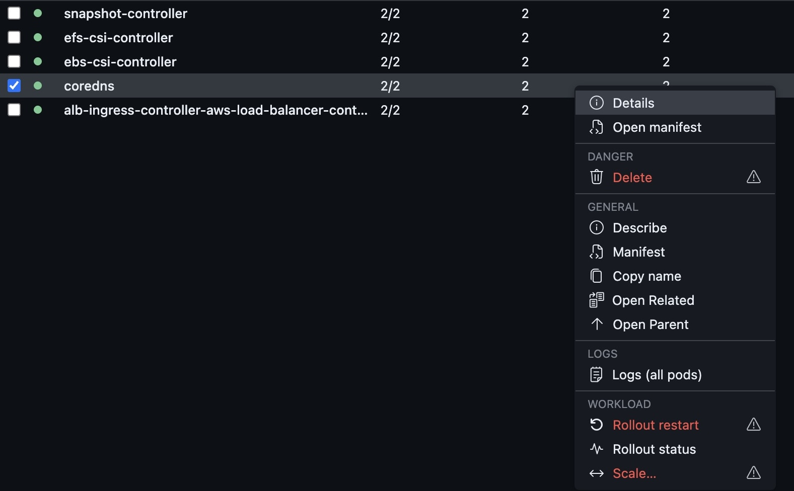

# K8s View

**See your workloads. Follow their pods. Read their logs. Stay in VS Code.**

K8s View brings your Kubernetes resources into interactive editor tables with a sidebar for context and view selection. Pick a cluster and
namespace, open a built-in view, and start exploring — no JSON configuration needed.

[**Install from the VS Code Marketplace**](https://marketplace.visualstudio.com/items?itemName=yunerou.k8s-view)
· [Report an issue](https://github.com/yunerou/k8s-view/issues)
· [Vietnamese guide](https://github.com/yunerou/k8s-view/blob/main/k8s-view/docs/README.md)

*Captured from K8s View 0.0.6 in VS Code against a live cluster. Sensitive identifiers have been blurred.*

## What’s new in 0.0.6

- **Views open in editor tabs.** The sidebar now lists views directly; Context and Snippets remain alongside them.
- **Compare the same view in multiple tabs.** Open another Workload, Service or custom view with its own session.
- **Choose a context per tab.** Independent context lets one tab use a different cluster or namespace while other tabs follow the shared Context selection.
- **Inspect Pod containers in Overview.** Read each container’s image, command, arguments and resource requests/limits alongside its identity and documentation link.
- **Start investigations in Related.** The detail drawer opens with related resources and puts Describe, Manifest and Run commands at the top.
- **Load only the active section.** Tables watch their active section; other sections may show previously loaded data and do not show a count until it is known.

The current table also includes expression filters, grouping by any column, a Parent drawer tab and live Related/Parent tables, described below.

For a step-by-step explanation in Vietnamese, see the [0.0.6 feature guide](https://github.com/yunerou/k8s-view/blob/main/k8s-view/FEATURES.vi.md).

## Start with your first workload

1. **Install K8s View.** VS Code also installs its dependency, Microsoft's
   [Kubernetes extension](https://marketplace.visualstudio.com/items?itemName=ms-kubernetes-tools.vscode-kubernetes-tools).
2. **Open K8s View** from the Activity Bar. In **Context**, choose a cluster from your kubeconfig and a namespace.
3. In the **View** sidebar section, click **Workload** to open its Full view in an editor tab, then select **Deployments**.
4. Filter and sort the table. Double-click a row to inspect it and expand its **Related** resources;
   right-click for the actions available on that resource.

Prefer the Command Palette? Run **K8s View: Select context…**, then **K8s View: Open as table**.

**You need:** VS Code **1.125 or newer**, a valid kubeconfig and access to a Kubernetes cluster. Have `kubectl`
available for actions such as Describe, Exec and Port-forward. If your cluster uses an authentication plugin
such as `aws`, `kubelogin` or `gke-gcloud-auth-plugin`, that plugin must be available to VS Code too.

## Everyday Kubernetes, a few clicks away

### Find the resource you need

Choose a view from the sidebar to open its table in the Editor. Cluster and namespace buttons in **Context** open VS Code Quick Pick menus.

#### Compare clusters or namespaces in separate tabs

1. Right-click a view in the sidebar and choose **Open in New Tab**, or click **Open in New Tab** in an open table’s editor title bar. You can also run **K8s View: Open in New Tab**.
2. The new tab starts with **Independent context** enabled. When opened from a table of the same view, it starts from that table’s cluster and namespace; otherwise it starts from the shared Context selection.
3. Use the cluster and namespace buttons in the table header to choose this tab’s context. These controls are enabled while **Independent context** is on. The namespace picker also offers **All namespaces** and **Enter namespace…**.
4. Drag the tab into another editor group to compare tables side by side. Each table has its own resource session.

You can also enable **Independent context** in an existing table. Changes in the sidebar’s **Context** then leave that tab’s selection in place. Turn the toggle off to follow the current shared context again. Closing the tab discards its private context without changing the shared selection; the private selection is not restored after a window reload.

For example, leave the sidebar on `kube-system`, open another Workload tab, and choose `cert-manager` there. The screenshot shows the tab’s namespace differing from the sidebar’s namespace.

#### Filter, group and arrange resources

- **Filter by name**, sort by a column, or turn on **column filters** to narrow the list further.
- **Group rows** by kind, namespace, status, a resource label or any column (for example Pods by Node).
- **Choose your columns:** hide, reorder and resize them; use **Save to config** to keep the layout in a view definition.
- **See health at a glance:** readiness counts, status colors, and highlighted warning or error rows.
- **Check CPU and memory** in the Pods and Node tables. Usage requires the cluster's metrics API and permission
  to read it; unavailable values appear as `-`.

Click the funnel button to show a filter field under each column. Filters are remembered per section, so a Pods filter does not become a Deployments filter.

| Expression | Meaning |
| --- | --- |
| `>0`, `>=2`, `<=5` | Numeric comparison, such as restarts or available replicas |
| `<1h`, `>=2d` | Resource age; duration suffixes include `s`, `m`, `h`, `d` and `w` |
| `>500m` | CPU usage above 500 millicores, in a CPU column |
| `>1Gi` | Memory above 1 GiB, in a memory column |
| `>100%` | A percentage above 100, in a percentage column |
| `=Running`, `!=Running` | Exact text equality or inequality, ignoring case |
| `!pending` | Text does not contain `pending` |
| `Running\|Pending` | Either text match in the same column |

Use column qualifiers in the search box to combine filters, for example `restarts:>0 age:<1h`, with ordinary text to find a particular workload. Different column filters combine with AND; `|` alternatives within one expression combine with OR. Qualifiers use a column ID or its title slug. Invalid expressions are marked with an explanation and do not filter out rows; correct the expression to apply it.

Choose **Group by → Node** in Pods to organize Pods by their assigned Node, or choose another column, namespace, kind, status or resource label. Choose **None** to return to a flat table. Column visibility, order and width can be adjusted separately; **Save to config** writes the column layout to the view definition.

Select **Live** in Context for watch updates, choose **3s / 5s / 10s** polling, or **Pause** while you investigate. Only the active table section is watched. Counts on unvisited sections may be absent, and inactive sections can retain previously loaded data until you open them.

### Inspect a workload without losing your place

Double-click a table row to open its details alongside the list. Use **Describe**, **Manifest** and **Run commands** at the top of the drawer. Drag the drawer’s left edge to resize it, use its refresh button to reload details, or press `Escape` to close it. The selected detail tab stays selected when you open another resource.

| Tab | What you can check |
| --- | --- |
| **Related** | Shown first; expand related resources, such as a Deployment's ReplicaSets and their Pods |
| **Overview** | Identity, readiness, age, labels, official documentation, and Pod containers with image, command, args and resources |
| **Events** | Events associated with the resource |
| **Conditions** | Status, reasons and messages reported by Kubernetes or a controller |
| **Parent** | Owners and other resources that point at this one, such as selecting Services, Nodes or routes |

#### Inspect container configuration in Pod Overview

Open **Workload → Pods**, double-click a Pod and choose **Overview**. In addition to identity, status, labels, owners and UID, the **Containers** area shows each container’s:

- **Image:** the configured registry, repository and tag or digest.
- **Command** and **Args:** the arrays declared in the Pod specification. An empty array means there is no explicit override in the Pod spec; it does not show the image’s default entrypoint.
- **Resources:** configured requests and limits. These are the Pod’s declared settings; live CPU and memory usage appears in the table when the metrics API is available.

For supported built-in kinds, **Documentation** links directly to the corresponding official Kubernetes guide.

#### Follow related resources and parents in their own tables

In **Related**, expand a Deployment’s ReplicaSet to see its Pods. **Parent** follows relations in the other direction: a Pod can show its owner ReplicaSet, assigned Node, selecting Service or PodDisruptionBudget. Available relations depend on the view definitions and resource data.

Choose **Open in table** in either drawer tab, or right-click a row and choose **Open Related** / **Open Parent**. The resulting tab lists resources within the source resource’s scope and keeps the relation up to date as resources change.

- The **Scope** chip identifies the source; click its name to open the source manifest.
- Click the chip’s **×** to show all resources of the tab’s resource kinds, within its current context and namespace.
- Click **Restore** to apply the source scope again.
- Use the scoped table’s normal sections, sorting, filters and detail drawer to continue investigating.

### Read logs from every pod in a workload

Right-click a Deployment, StatefulSet, DaemonSet, ReplicaSet or Job → **Logs (all pods)**.
K8s View streams their logs into one terminal, with a different color for each `pod/container` prefix and
highlighted log levels. New matching pods are picked up automatically during a rollout or scale operation.

For a single Pod, choose **Logs** or **Logs of container…**. Logs stream directly from the Kubernetes API;
they do not require `kubectl`.

### Run the right action on the right resource

Right-click a resource in the table to see its available actions. The selected context and
namespace travel with the action, so you do not have to copy resource names into a terminal.

| When you want to… | Choose… |
| --- | --- |
| Read a manifest or investigate a resource | **Manifest** or **Describe** |
| Open a shell in a running Pod | **Commands… → Exec shell**; choose a container |
| Access a Pod or Service locally | **Port-forward…**; enter `local:remote`, then manage it in the **Service** view |
| Open an application's route | **Open in browser** on supported Ingress or HTTPRoute resources |
| Inspect a Secret | **Decrypt secret**, or reveal/copy a single decoded value on demand |
| Restart or scale workloads | **Rollout restart** or **Scale…**, after enabling the dangerous-command policy |

**Delete** is available for custom and cluster-scoped resources as well as built-in kinds, including mixed multi-selections. The dangerous-command policy still applies.

The table also supports **multi-select** for commands on several resources, including batch actions such as
copying names, restarting workloads and scaling replicas.

## Built-in views for more than Pods

Click a view in the sidebar, or use **Switch view…** in the View title bar. Hide the ones you do not use with
**Show/hide views…**.

| View | Explore |
| --- | --- |
| **Workload** | Deployments, StatefulSets, DaemonSets, ReplicaSets, Pods, CronJobs and Jobs, with their children |
| **Service** | Services and their Pods, Ingress, HTTPRoute and active port-forwards |
| **Config** | ConfigMaps, Secrets and their keys |
| **Node** | Readiness, pressure, capacity, CPU/memory and Pods assigned to each Node |
| **Event** | Warnings and other events, including events for cluster-scoped resources |
| **Volume** | PVCs, PVs, StorageClasses, snapshots, attachments and related resources |
| **Scaling** | HPA, VPA, KEDA and PodDisruptionBudgets, linked to their workloads |
| **ServiceAccount** | ServiceAccounts and the bindings and roles that grant their permissions |
| **Gateway API** | Gateways, routes, policies, GatewayClasses and ReferenceGrants |
| **CRDs** | Custom resource definitions, API versions, conditions and **List instances** |
| **Single resource kind** | Browse any resource kind served by your cluster, including custom resources |

**FluxCD and cert-manager presets appear automatically when their CRDs are present.** Trace Flux resources,
inspect HelmRelease values, or follow Certificates and their related resources. Viewing HelmRelease values
does not require the `helm` CLI. Actions such as `flux reconcile` or `cmctl renew` need their respective CLIs.
Sections for resource kinds absent from your cluster are hidden automatically.

## Make it fit your workflow

The built-in views work on their own. When you want more control, you can add these features gradually.

### Reuse commands with snippets

The **Snippets** section contains commands that follow your selected context or namespace. Start with
**Events**, **Containers & images in use**, or **Find pods by label / annotation…**.

Use **+ → Create snippet…** to save a command through a wizard. Add parameters such as `${input:app}` and
K8s View asks for the value when you run it. You can also offer resource pickers and reuse previous input values.

### Navigate with keyboard shortcuts

Table hotkeys are **off by default**. Click **K8s keys: OFF** in the status bar to enable them while the table
has focus; press `?` for the full list.

| Key | Action |
| --- | --- |
| `/` | Focus the row filter |
| `d` / `y` | Open details / manifest |
| `c` | Open the selected resource's command menu |
| `e` / `Shift+e` | Jump to the next / previous error row |
| `n` / `v` | Pick a namespace / view |
| `[` / `]` | Previous / next section |
| `1`–`9` | Open a configured favorite view |

Set favorites with **K8s View: Configure favorite views…**. Hotkeys override VS Code bindings while active in
the table; typing in a filter still enters text normally.

### Build a view for your team

Choose **Switch view… → Create custom view…** to start with a wizard. JSON view definitions let you choose
resource kinds, columns, status rules, filters and parent–child relationships. Built-in views use the same
format, so you can extend one instead of starting from scratch.

Store definitions in `.vscode/k8s-view/*.json` for a workspace, or `~/.config/k8s-view/*.json` for personal use
across workspaces. JSON files support comments, IntelliSense and validation. Teams can also share definitions
through HTTPS remote configs with command allowlists.

See the [configuration reference](https://github.com/yunerou/k8s-view/blob/main/k8s-view/docs/configuration-reference.md)
for a complete example, settings and command safety rules.

## Stay aware of your cluster

- **Context selection is local to K8s View.** It does not change your kubeconfig's `current-context`. Following
  the Microsoft Kubernetes extension's selection is optional.
- **Dangerous commands are blocked by default.** Set `k8sView.commands.dangerous` to `confirm` if you want to
  review commands such as delete, scale and rollout restart before they run.
- **Protected contexts** can show a red status bar and require confirmation for every command.
- **Secret values stay out of the resource lists** and are displayed only when you explicitly reveal or decode them.

## Need a hand?

| If… | Try… |
| --- | --- |
| No context appears | Check that your kubeconfig is available through `KUBECONFIG`, `~/.kube/config` or the Kubernetes extension's kubeconfig setting. |
| Authentication has expired | Click **Reconnect** in Context. Supported exec-auth plugins can sign in again through an interactive terminal. |
| VS Code cannot find `aws`, `kubectl` or another CLI | Add its containing folder to `k8sView.extraPath`, then reconnect or retry the action. |
| You cannot list namespaces | Type the namespace name directly in the namespace picker. |
| A command is blocked | Check the dangerous-command policy, workspace trust or the remote config's command allowlist. |
| A resource kind is missing | Use **Single resource kind** and check your cluster's installed APIs and your RBAC permissions. |

[Detailed guides in Vietnamese](https://github.com/yunerou/k8s-view/blob/main/k8s-view/docs/README.md)
cover usage, custom views, commands, snippets and remote configuration.

**Enjoying K8s View?** If it saves you time, please
[leave a five-star review on the Marketplace](https://marketplace.visualstudio.com/items?itemName=yunerou.k8s-view&ssr=false#review-details).
Your feedback helps other Kubernetes users discover it. Found a problem or have an idea?
[Open an issue](https://github.com/yunerou/k8s-view/issues).
